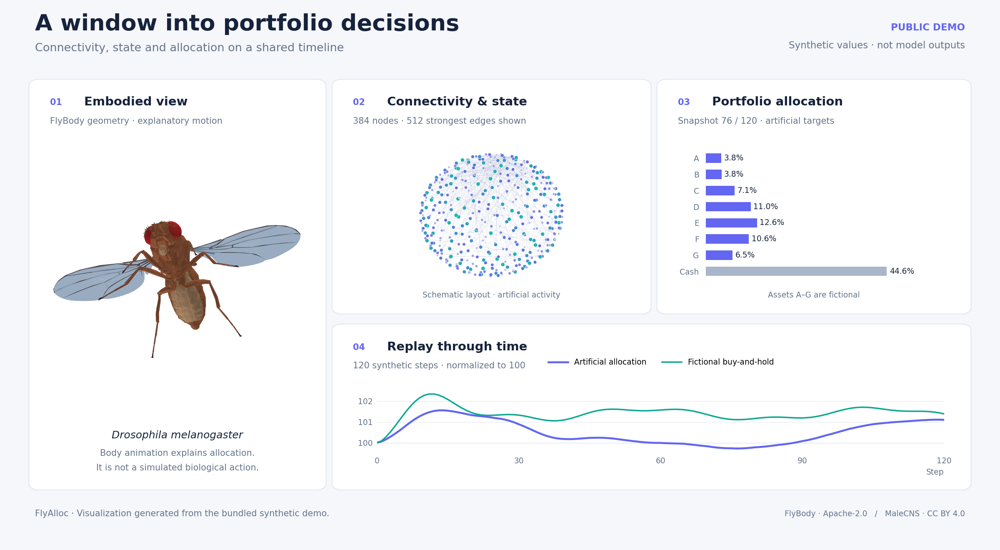
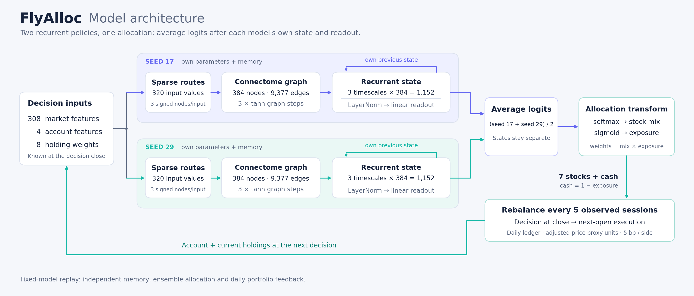

# FlyAlloc

**Connectome-inspired asset allocation with interactive neural-state visualization.**

**English** · [简体中文](README.zh-CN.md)

[Quick start](#quick-start) · [How it works](#how-it-works) · [Documentation](#documentation)

FlyAlloc explores how a neural policy constrained by fruit-fly connectivity can map market signals and portfolio state to asset allocations. It combines a stateful graph model with an interactive replay of portfolio weights, neural activity and returns.



*Overview generated from the public synthetic demo. Assets, activity and curves are illustrative; the connectivity is derived from MaleCNS. [Vector figure](docs/assets/overview.svg).*

## Quick start

Download the source and open a terminal in the project directory. The web viewer requires **Python 3.10+** and no package installation.

```bash
# macOS / Linux
python3 serve.py start
```

```powershell
# Windows
py -3 serve.py start
```

Open the address printed in the terminal, normally **http://127.0.0.1:8080/**. The bundled demo runs locally with no external services. It uses fictional assets and synthetic values to demonstrate the interface; it does not run the research model. To replay research records, import an authorized local data bundle as described in the [running guide](docs/RUNNING.en.md).

## How it works



The model routes **308 market features, 4 account features and 8 holding weights** into a graph with **384 aggregated nodes and 9,377 edges**. Three propagation steps feed three memory timescales, producing a 1,152-dimensional state for each policy. Two independently parameterized policies average their output logits; a softmax allocates across seven stocks and a sigmoid sets total equity exposure, leaving the remainder in cash.

The research configuration rebalances every five observed trading sessions, with close-of-session decisions, execution at the next session’s adjusted opening-price proxy and a 5bp cost per traded side. The viewer synchronizes allocations, activity and return curves to the recorded decision timeline. Body motion is illustrative, and graph positions are schematic. See the [model card](MODEL_CARD.md) for checkpoints, evaluation settings and interpretation.

## Documentation

| Guide | Contents |
| --- | --- |
| [Running the project](docs/RUNNING.en.md) | Startup, local data, CPU replay and verification |
| [Model card](MODEL_CARD.md) · 中文 | Architecture, checkpoints and research results |
| [Data sources](DATA_SOURCES.md) · 中文 | Provenance, permissions and distribution scope |
| [Figure sources](docs/assets/README.md) | Reproduce the figures and inspect their inputs |

For development checks, install **Node.js 22+** and run `npm test`. No npm dependencies are required. The public tests use only bundled demo data.

## Data and license

Original code and learned parameters are licensed under [MIT](LICENSE). MaleCNS-derived connectivity, including the connectivity buffers in model checkpoints, remains **CC BY 4.0**. FlyBody assets, Three.js and fonts retain their respective licenses; see [third-party notices](THIRD_PARTY_NOTICES.md).

The public repository includes synthetic demo data. Real market data, adjustment factors and price-bearing research records remain local because redistribution permission has not been established. Historical simulations are research artifacts, not evidence of future investment performance.
